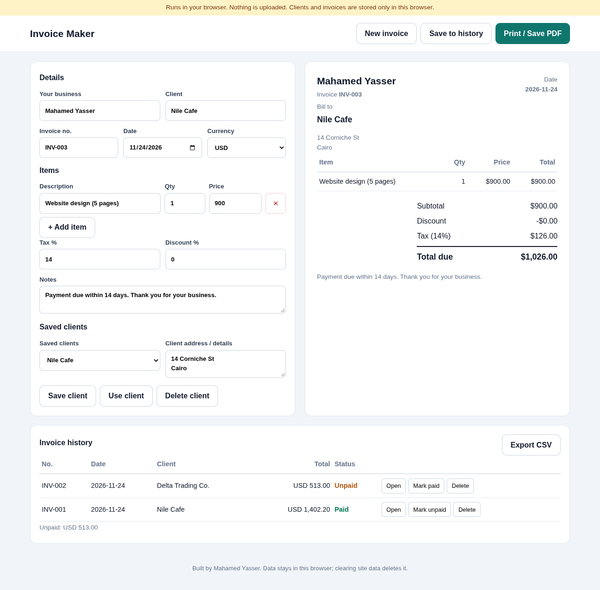

# Invoice Maker

_Screenshot with sample data entered through the page (fictional client and numbers)._

Browser invoice maker with saved clients, automatic numbering and an invoice history.

## What it does
- Line items, discount and tax percentages, five currencies, live totals and preview
- Saved clients: save a client with an address, load it later; the address appears on the invoice preview and print
- Automatic next invoice number (INV-001, INV-002 ...); saving the same number updates that invoice instead of duplicating it
- Invoice history: open an invoice again, mark paid or unpaid, delete, see the unpaid total, export the history as CSV
- Print layout for Save as PDF (uses the browser print dialog; the history and editor are hidden when printing)
- Validation: business, client and at least one priced item are required before saving
- Data stays in this browser (localStorage)

## Run it
Open `index.html` in a browser. No install, no build, no server, no account.

## Tests and limits
- Browser-tested in headless Chrome: 20 checks passed on the current code (clients, address in preview, numbering, history, paid status, CSV, persistence, XSS escaping, invalid invoices not saved, plus a mobile layout check).
- It does not email invoices or create PDF files itself, and it does not sync between devices. Clearing site data deletes everything.
- Plain HTML, CSS and JavaScript, no frameworks.

Built by Mahamed Yasser.
